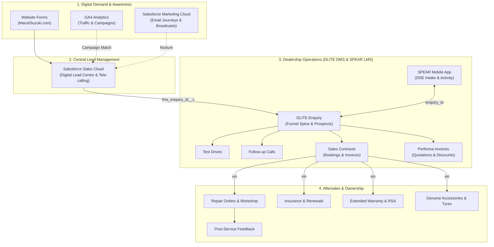

# Maruti Suzuki Data Model & Schema Mapping

This document provides a comprehensive mapping of all **36 datasets and tables** within the Maruti Suzuki Marketing & Sales Intelligence data model (`maruti_schema_simulated_v1` / `maruti.sqlite`).

---

## 1. High-Level Architecture & Domain Overview

The data model unifies six core business systems across the automotive customer lifecycle:

---

## 2. Master Mapping Table (All 36 Tables)

| # | Source System | Source Sheet Name | SQLite Table Name | Business Domain | Row Count | Primary Key | Key Join Keys / Foreign Keys | Description & Business Grain |
|:---:|:---|:---|:---|:---|:---:|:---|:---|:---|
| **1** | DLITE (DMS) | `DLITE_Enquiry table` | `sheet_dlite_enquiry_table` | Sales | 9,000 | `enquiry_id` | `dealer_code`, `customer_id`, `sales_consultant_id` | **Core sales funnel spine**: 1 row per vehicle enquiry (prospect). Model, variant, dealer, zone, status (`Open`, `Booked`, `Invoiced`, `Lost`), lost reason, competitor brand/model. |
| **2** | DLITE (DMS) | `DLITE_Contract table` | `sheet_dlite_contract_table` | Sales | 1,000 | `contract_id` | `enquiry_id`, `dealer_code`, `loyalty_vehicle_vin` | **Vehicle bookings**: 1 row per booking contract. Status (`Booked`, `Cancelled`, `Invoiced`), cancellation reasons, expected delivery dates, loyalty discounts. |
| **3** | DLITE (DMS) | `DLITE_Performa table` | `sheet_dlite_performa_table` | Sales | 1,000 | `enquiry_id` | `enquiry_id`, `dealer_code` | **Price quotations**: 1 row per proforma invoice. Ex-showroom, road tax, dealer discounts, on-road pricing, EW, RSA. |
| **4** | DLITE (DMS) | `DLITE_test drive` | `sheet_dlite_test_drive` | Sales | 1,000 | `enquiry_id` | `enquiry_id`, `dealer_code` | **Test drives**: 1 row per test drive appointment. Scheduled vs actual times, location (`Home`/`Showroom`), outcome (`Completed`, `Cancelled`, `No show`). |
| **5** | DLITE (DMS) | `DLITE_salesfollowup table` | `sheet_dlite_salesfollowup_table` | Sales Activity | 13,500 | *(Composite)* | `enquiry_id`, `owner` (= `sales_consultant_id`) | **Enquiry follow-ups**: 1 row per follow-up call. Call discipline, sub-status (`Connected`, `Ringing`), consultant remarks, next follow-up date. |
| **6** | DLITE (DMS) | `DLITE_Dealer Table` | `sheet_dlite_dealer_table` | Master | 1,000 | `dealer_code` | `dealer_id`, `dealer_brand_name` | **Universal Dealer Master**: 1 row per dealership outlet. Channel (`ARENA` / `NEXA`), Zone (`NORTH1..2`, `SOUTH1..2`, `EAST`, `WEST1..2`), Tier, State, City, targets. |
| **7** | DLITE (DMS) | `DLITE_Customer table` | `sheet_dlite_customer_table` | Master | 1,000 | `customer_id` | `customer_id`, `asset_id` | **Customer master**: 1 row per unique customer record. Contact details, occupation, customer segment (~43% match to enquiries). |
| **8** | DLITE (DMS) | `DLITE_vin table` | `sheet_dlite_vin_table` | Master | 1,000 | `asset_row_id` | `vin`, `dealer_code` | **Vehicle registry master**: 1 row per registered VIN with model, engine number, sale date, primary dealer. |
| **9** | DLITE (DMS) | `DLITE_Ownership table` | `sheet_dlite_ownership_table` | Master | 1,000 | `vin` | `vin`, `customer_id` | **Vehicle ownership history**: 1 row per registered ownership period (first owner, secondary owner, transfer date). |
| **10** | DLITE (DMS) | `DLITE_Payment Table` | `sheet_dlite_payment_table` | Master | 1,000 | `honda_staff_id` | `user_id` (= `sales_consultant_id`) | **Dealer staff master**: 1 row per employee. Staff designation, showroom department, role (covers ~400 sales consultants). |
| **11** | DLITE (DMS) | `DLITE_RO_table` | `sheet_dlite_ro_table` | Aftersales | 1,000 | `order_num` | `vin`, `service_dealer_code`, `service_request_number` | **Workshop repair orders**: 1 row per service job card. Service type (`Free`/`Paid`/`Accidental`), labour bill, parts bill, total invoice, turnaround time. |
| **12** | DLITE (DMS) | `DLITE_PSF table` | `sheet_dlite_psf_table` | Aftersales | 1,000 | `activity_id` | `vin`, `sr_number` (= `service_request_number`) | **Post-service feedback**: 1 row per post-service call survey. Customer satisfaction score, service rating, grievance category. |
| **13** | DLITE (DMS) | `DLITE_SDR table` | `sheet_dlite_sdr_table` | Aftersales | 1,000 | `activity_id` | `vin`, `dealer_code` | **Service delivery review**: 1 row per audit on delivered repair orders, quality checks, washing/cleaning compliance. |
| **14** | DLITE (DMS) | `DLITE_et_atw table` | `sheet_dlite_et_atw_table` | Aftersales | 1,000 | `vin` | `vin`, `dealer_code` | **Extended warranty (EW)**: 1 row per warranty contract. Policy start/expiry dates, warranty tier, coverage amount. |
| **15** | DLITE (DMS) | `DLITE_insurance table` | `sheet_dlite_insurance_table` | Aftersales | 1,000 | `policy_number` | `vin`, `dealer_code` | **Motor insurance**: 1 row per policy renewal. Insurer name (MIBA), IDV, premium paid, policy status. |
| **16** | DLITE (DMS) | `DLITE_RSA table` | `sheet_dlite_rsa_table` | Aftersales | 1,000 | `policy_number` | `vin`, `mtoc` | **Roadside assistance**: 1 row per RSA subscription. Package tier, validity duration, emergency call logs. |
| **17** | DLITE (DMS) | `DLITE_accessories table` | `sheet_dlite_accessories_table` | Aftersales | 1,000 | `ro_number` | `vin`, `dealer_code` | **MGA (Maruti Genuine Accessories)**: 1 row per accessory fitment order. Part SKU, accessory revenue, installation type. |
| **18** | DLITE (DMS) | `DLITE_Tyre_battery table` | `sheet_dlite_tyre_battery_table` | Aftersales | 1,000 | *(Composite)* | `ro_number` (= `DLITE_RO_table.order_num`), `vin` | **Tyre & battery replacements**: 1 row per component replacement order, brand fitted, warranty status. |
| **19** | DLITE (DMS) | `DLITE_Complaint table` | `sheet_dlite_complaint_table` | Aftersales | 1,000 | `sr_row_id` | `vin`, `dealer_code` | **Customer grievances**: 1 row per complaint escalated. Root cause, resolution turnaround, department assigned. |
| **20** | DLITE (DMS) | `DLITE_event addition` | `sheet_dlite_event_addition` | Marketing | 1,000 | `event_row_id` | `event_id`, `dealer_code` | **Local dealer marketing events**: 1 row per showroom event, mall display, loan mela, footfall and budget. |
| **21** | SPEAR (LMS) | `spear_new_enquiry_prod_table` | `sheet_spear_new_enquiry_prod_table` | Sales | 1,500 | `id_2` | `id` (= `DLITE_Enquiry.enquiry_id`), `dealer_code` | **Dealer mobile LMS (Intake)**: 1 row per inquiry logged via mobile app. Digital vs manual mode, initial consultant assignment. |
| **22** | SPEAR (LMS) | `spear_update_enquiry_prod_table` | `sheet_spear_update_enquiry_prod_table` | Sales | 1,500 | `id_2` | `id` (= `DLITE_Enquiry.enquiry_id`), `sc_username` | **Dealer mobile LMS (Updates)**: 1 row per lead progression update, stage shifts, consultant handovers. |
| **23** | SPEAR (LMS) | `spear_lms_followup_update` | `sheet_spear_lms_followup_update` | Sales Activity | 1,500 | `id_2` | `enquiryid` (= `DLITE_Enquiry.enquiry_id`) | **Mobile follow-up logs**: 1 row per field consultant activity update on an inquiry. |
| **24** | SPEAR (LMS) | `spear_manpower_prod_table` | `sheet_spear_manpower_prod_table` | Master | 1,500 | `user_id` | `username` (= `sc_username`), `dealer_code` | **Showroom mobile users**: 1 row per active app user, role (`DSE`, `Team Lead`), login activity status. |
| **25** | SFDC (CRM) | `SFDC_leads_table` | `sheet_sfdc_leads_table` | Sales | 5,000 | `id_2` | `lms_enquiry_id__c` (= `enquiry_id`), `dealercode__c` | **Digital Lead Centre (DLC)**: 1 row per online lead. Source/medium/campaign, lead score, rating (`Hot`/`Warm`/`Cold`), conversion flag. |
| **26** | SFDC (CRM) | `SFDC_opportunity_table` | `sheet_sfdc_opportunity_table` | Sales | 4,498 | `opportunity_id` | `Lead_ID` (= `SFDC_leads.id`), `Opportunity_ID` | **Qualified digital pipeline**: 1 row per converted lead opportunity. Stage (`Closed Won`, `Closed Lost`), deal amount. |
| **27** | SFDC (CRM) | `SFDC_call_summary_table` | `sheet_sfdc_call_summary_table` | Sales Activity | 1,500 | `id_2` | `lead__c` (= `SFDC_leads.id`) | **Central call centre logs**: 1 row per outbound call attempt to digital leads. Call duration, IVR status, connect outcome. |
| **28** | SFDC (CRM) | `SFDC_agent_disposition_table` | `sheet_sfdc_agent_disposition_table` | Sales Activity | 5,000 | `id_2` | `lead__c` (= `SFDC_leads.id`) | **Tele-calling agent dispositions**: 1 row per agent qualification outcome (`Interested`, `Not Interested`, `Callback`, `Invalid`). |
| **29** | SFMC (Email) | `SFMC_data_view_jobs` | `sheet_sfmc_data_view_jobs` | Marketing | 1,260 | *(Composite)* | `jobid` | **Email broadcast campaigns**: 1 row per email job executed. Subject line, target audience size, delivery status. |
| **30** | SFMC (Email) | `SFMC_sends_events_data` | `sheet_sfmc_sends_events_data` | Marketing | 1,260 | `event_detail` | `job_id` (= `jobid`) | **Send events**: 1 row per sent event batch with aggregate sends, deliverability, and JSON event detail payload. |
| **31** | SFMC (Email) | `SFMC_opens_events_data` | `sheet_sfmc_opens_events_data` | Marketing | 1,260 | `event_detail` | `job_id` (= `jobid`) | **Open events**: 1 row per open batch. Unique opens, open rate calculation (`unique_opens / delivered`). |
| **32** | SFMC (Email) | `SFMC_clicks_events_data` | `sheet_sfmc_clicks_events_data` | Marketing | 1,260 | `event_detail` | `job_id` (= `jobid`) | **Click events**: 1 row per click batch. Unique clicks, click-through rate (`unique_clicks / delivered`). |
| **33** | SFMC (Email) | `SFMC_bounce_events_data` | `sheet_sfmc_bounce_events_data` | Marketing | 1,260 | `event_detail` | `job_id` (= `jobid`) | **Bounce events**: 1 row per bounce batch. Hard bounces, soft bounces, invalid email breakdown. |
| **34** | SFMC (Email) | `SFMC_all_campaigns_contact` | `sheet_sfmc_all_campaigns_contact` | Marketing | 1,260 | *(Composite)* | `subscriberkey` | **Marketing Cloud contact list**: 1 row per subscribed customer profile and list membership. |
| **35** | Digital (Web) | `Website_data` | `sheet_website_data` | Digital | 12,000 | `td_client_id` | `dealer` (= `DLITE_Dealer Table.dealer_id`), `model` | **MarutiSuzuki.com web interactions**: 1 row per online form fill (e-book, test drive request, brochure download, dealer locator). |
| **36** | Digital (Web) | `GA4` | `sheet_ga4` | Digital | 500 | `batch_page_id` | `campaign` (~ `SFDC_leads_table.utm_campaign__c`) | **Google Analytics 4 aggregates**: 1 row per campaign/page daily session batch. Pageviews, engaged sessions, bounce rate, event counts. |

---

## 3. Verified Relationship & Join Matrix

Use these explicit join pairs when constructing analytical SQL queries:

| Join Category | From (Source Table & Column) | To (Target Table & Column) | Cardinality | Match Quality & Analytical Use Case |
|:---|:---|:---|:---:|:---|
| **Sales Funnel Spine** | `sheet_dlite_enquiry_table.enquiry_id` | `sheet_dlite_contract_table.enquiry_id` | `1 : 0..1` | **100% of bookings match**. Core conversion metric: Enquiry-to-Booking rate. |
| **Price Quotations** | `sheet_dlite_enquiry_table.enquiry_id` | `sheet_dlite_performa_table.enquiry_id` | `1 : 0..1` | **100% match**. Connects enquiry to quote pricing, on-road prices, and discounts. |
| **Test Drive Funnel** | `sheet_dlite_enquiry_table.enquiry_id` | `sheet_dlite_test_drive.enquiry_id` | `1 : 0..N` | **100% match**. Test drive completion and test-drive-to-booking conversion. |
| **Enquiry Follow-ups** | `sheet_dlite_enquiry_table.enquiry_id` | `sheet_dlite_salesfollowup_table.enquiry_id` | `1 : 0..N` | **100% match**. Call discipline, connect rates, and follow-up lag analysis. |
| **Digital Lead to Enquiry** | `sheet_sfdc_leads_table.lms_enquiry_id__c` | `sheet_dlite_enquiry_table.enquiry_id` | `N : 1` | **100% of converted leads match**. Full digital funnel attribution to dealership sale. |
| **SPEAR Mobile Intake** | `sheet_dlite_enquiry_table.enquiry_id` | `sheet_spear_new_enquiry_prod_table.id` | `1 : 0..1` | **100% match**. Cross-verifies mobile app enquiry creation. |
| **SPEAR Mobile Updates** | `sheet_dlite_enquiry_table.enquiry_id` | `sheet_spear_update_enquiry_prod_table.id` | `1 : 0..1` | **100% match**. Tracks enquiry progression in field consultant app. |
| **SPEAR Mobile Follow-up**| `sheet_dlite_enquiry_table.enquiry_id` | `sheet_spear_lms_followup_update.enquiryid` | `1 : 0..N` | **100% match**. Field consultant mobility follow-up notes. |
| **Digital CRM Funnel** | `sheet_sfdc_leads_table.id` | `sheet_sfdc_opportunity_table.Lead_ID` | `1 : 0..1` | **100% match**. Digital qualified lead to pipeline opportunity. |
| **Digital Call Centre** | `sheet_sfdc_leads_table.id` | `sheet_sfdc_call_summary_table.lead__c` | `1 : 0..N` | **100% match**. Speed-to-lead and call duration analysis. |
| **Agent Dispositions** | `sheet_sfdc_leads_table.id` | `sheet_sfdc_agent_disposition_table.lead__c` | `1 : 0..N` | **100% match**. Tele-caller disposition breakdown (`Interested`, `Callback`, etc.). |
| **Dealer Master (Universal)** | `sheet_dlite_dealer_table.dealer_code` | `*.[dealer_code / dealercode__c]` | `1 : N` | **100% match across all sheets**. Essential for Channel (`ARENA` vs `NEXA`), Zone, State, and City benchmarks. |
| **Dealer ID Link** | `sheet_dlite_dealer_table.dealer_id` | `sheet_website_data.dealer` | `1 : N` | **100% match**. Connects website lead interest to specific dealer showroom. |
| **Workshop to Tyres/Battery**| `sheet_dlite_ro_table.order_num` | `sheet_dlite_tyre_battery_table.ro_number` | `1 : N` | **~64% match**. Workshop repair orders requiring tyre/battery replacements. |
| **Workshop to PSF Survey** | `sheet_dlite_ro_table.service_request_number` | `sheet_dlite_psf_table.sr_number` | `1 : 0..1` | **~62% match**. Post-service survey response against workshop repair order. |
| **Vehicle Master** | `sheet_dlite_vin_table.vin` | `sheet_dlite_ro_table.vin`, `sheet_dlite_insurance_table.vin`, `sheet_dlite_rsa_table.vin`, `sheet_dlite_et_atw_table.vin`, `sheet_dlite_ownership_table.vin` | `1 : N` | **Partial (10% - 70% sample match)**. Vehicle lifecycle across repair orders, insurance policies, and warranty contracts. |
| **Email Broadcasts** | `sheet_sfmc_data_view_jobs.jobid` | `sheet_sfmc_*_events_data.job_id` | `1 : N` | **100% match**. Email campaign ID to sends, opens, clicks, and bounce telemetry. |
| **Campaign Attribution** | `sheet_ga4.campaign` | `sheet_sfdc_leads_table.utm_campaign__c` | `Aggregate` | **~67% of campaigns shared**. Connects aggregate web traffic sessions to CRM leads by campaign name. |

---

## 4. Critical Anti-Patterns (Links That Look Plausible But Do NOT Exist)

> [!WARNING]
> Do **NOT** join on the following columns under any circumstances:
>
> 1. **`td_client_id`** across `Website_data`, `GA4`, and `SFDC_leads_table`: They do **not** share visitor cookies/IDs. There is no row-level web-to-lead join.
> 2. **`DLITE_accessories table.ro_number`** vs **`DLITE_RO_table.order_num`**: Accessories order numbers are distinct from workshop repair orders.
> 3. **`DLITE_test drive.demo_car_vin`** vs Customer **`vin`**: Demo fleet vehicles are separate from sold customer vehicles.
> 4. **`DLITE_Enquiry table.order_id`** vs **`DLITE_Contract table.contract_id`**: These do not match. Always link bookings to enquiries using **`enquiry_id`**.
> 5. **`DLITE_Enquiry table.event_id__if_any_`** / **`SFDC_leads_table.event_id__c`** vs **`DLITE_event addition.event_id`**: Transaction event IDs rarely match the marketing event master.

---

## 5. Canonical Business Metrics & Formulas

When computing metrics, follow these single-source-of-truth definitions:

| Metric | Source Table | Filter / Formula | Business Meaning |
|:---|:---|:---|:---|
| **Enquiries** | `sheet_dlite_enquiry_table` | `COUNT(*)` dated by `creation_date` | Total customer purchase intent generated. |
| **Bookings (Cumulative)**| `sheet_dlite_enquiry_table` | `LOWER(enquiry_status) IN ('booked', 'invoiced')` | Total converted orders. |
| **Pending / Open Orders** | `sheet_dlite_enquiry_table` | `LOWER(enquiry_status) = 'booked'` | Booked vehicles awaiting dispatch/retail. |
| **Retail Sales / Deliveries**| `sheet_dlite_enquiry_table` | `LOWER(enquiry_status) = 'invoiced'` dated by `order_date` | Handed over vehicles (actual retail revenue). |
| **Lost Sales** | `sheet_dlite_enquiry_table` | `LOWER(enquiry_status) = 'lost'` | Prospects lost; analyze `lost_sales_reason` and `manufacturer`. |
| **Enquiry-to-Booking %** | `sheet_dlite_enquiry_table` | `(Bookings / Enquiries) * 100` | Dealership sales conversion efficiency. |
| **Booking-to-Retail %** | `sheet_dlite_enquiry_table` | `(Retail Deliveries / Bookings) * 100` | Fulfillment and cancellation resilience. |
| **Cancellation %** | `sheet_dlite_contract_table` | `COUNT(*) FILTER (WHERE LOWER(status) = 'cancelled') / COUNT(*)` | Order fallout rate before vehicle handover. |
| **Test Drive Completion %**| `sheet_dlite_test_drive` | `COUNT(*) FILTER (WHERE LOWER(status) = 'completed') / COUNT(*)` | Proportion of scheduled drives fulfilled. |
| **Email Open Rate (SFMC)** | `sheet_sfmc_opens_events_data` | `unique_opens * 1.0 / delivered` | Email subject line & timing engagement. |
| **Email CTR (SFMC)** | `sheet_sfmc_clicks_events_data` | `unique_clicks * 1.0 / delivered` | Email content & CTA effectiveness. |
| **Speed to Lead (SLA)** | `sheet_sfdc_leads_table` | `AVG(first_connected_in__c)` (in minutes) | Response time from web form fill to first call. |
| **Channel (ARENA / NEXA)** | `sheet_dlite_dealer_table` | Joined on `dealer_code`: `dealer_type` | Network split (`ARENA` mass-market vs `NEXA` premium). |
| **Fuel Type** | `sheet_dlite_enquiry_table` | Derived from `type`: `CNG` if `UPPER(type) LIKE '%CNG%'`, `Hybrid` if `LIKE '%HYBRID%'`, else `Petrol` | Powertrain mix. |
