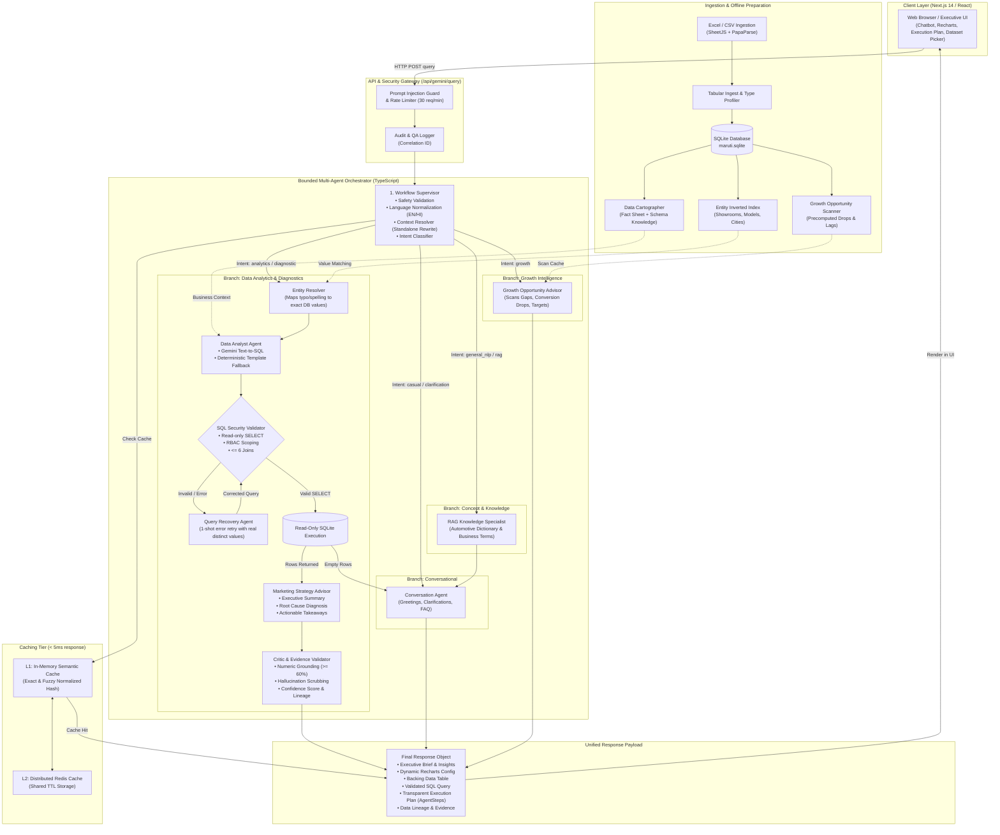
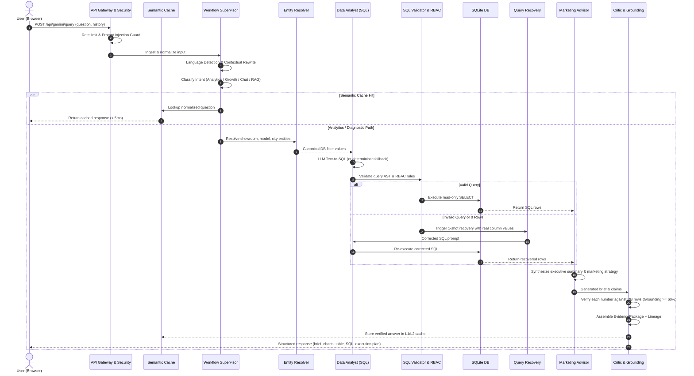

# Maruti Suzuki Marketing Intelligence Assistant

Ask business questions about your sales / marketing data in plain English (or Hindi / Hinglish) and get back a short brief, a chart, the table behind it, and the exact SQL that produced every number.

> *"Which showroom is performing best in Gujarat?"* · *"Why is Pune lagging?"* · *"How can we grow sales next quarter?"*

You load a spreadsheet (upload, or pick one from the client folder). The app turns it into SQLite tables. A small team of **agents** answers each question from those tables.

---

## Contents

1. [Quick start](#quick-start)
2. [The big picture](#the-big-picture)
3. [How the multi-agent flow works](#how-the-multi-agent-flow-works)
4. [What happens when data is loaded](#what-happens-when-data-is-loaded)
5. [Caching: which caches and why](#caching-which-caches-and-why)
6. [Tech stack and why each piece](#tech-stack-and-why-each-piece)
7. [Safety and trust](#safety-and-trust)
8. [Configuration](#configuration)
9. [Project layout](#project-layout)

---

## Quick start

### Option A: Docker (recommended)

Starts the Next.js app and Redis together.

```bash
cp .env.example .env.local      # then add your GEMINI_API_KEY
./start.sh                      # build + run, waits until healthy
```

| Command | What it does |
|---|---|
| `./start.sh --logs` | Follow container logs |
| `./start.sh --stop` | Stop and remove containers |
| `./start.sh --restart` | Restart containers |
| `./start.sh --build` | Force an image rebuild |
| `./start.sh --attach` | Run in the foreground |

Put client datasets in `./data/client` (or set `CLIENT_DATA_HOST_DIR`) and they appear in the dataset picker.

### Option B: Local Node.js

```bash
npm install
npm run dev          # http://localhost:3000
```

Without `GEMINI_API_KEY` the app still works in **deterministic mode**: template SQL plus rule-based summaries, with no LLM.

---

## The big picture



- **Frontend:** Next.js pages and React components (chat, charts, dataset picker).
- **Backend:** Next.js API routes running on Node. There is no separate server to deploy.
- **Data:** a local SQLite file (`data/maruti.sqlite`).
- **AI:** Google Gemini. It is optional, and each call has a timeout and a fallback.

---

## How the multi-agent flow works

### The one-line version

A **supervisor** decides what kind of question it is. The question then goes down **one fixed path** through specialist agents, and a **critic** checks every number before the answer goes out.

> 📖 **Deep Dive:** For full architectural specifications, sequence diagrams, latency budgets, and agent contracts, see the [Multi-Agent Workflow Guide](src/lib/multi-agent/README.md).

### Why "bounded"?

Many multi-agent systems let the LLM decide which agent to call next, which can loop for a long time. This one doesn't. The route is plain TypeScript (`src/lib/multi-agent/bounded-orchestrator.ts`), so:

- A data answer makes **at most two main LLM calls**: one to write SQL and one to write the summary. A short follow-up may add one rewrite call.
- The LLM work has a **time budget of 20s**, or 28s when a large data dictionary is in the prompt. If the budget runs out, the summary step is skipped and a rule-based summary is used.
- Every agent writes an `AgentStep` (what it thought, what it did, how long it took). The UI shows these steps as the "execution plan", so users can see how an answer was built.

### The agents

| # | Agent | Uses LLM? | Job |
|---|---|---|---|
| 1 | **Supervisor** | no | Blocks prompt injection, detects language (EN/HI/Hinglish), turns follow-ups into standalone questions, and classifies intent |
| 2 | **Data Cartographer** | once per dataset | Shares its whole-dataset understanding, built at load time, with every other agent (see below) |
| 3 | **RAG Knowledge Specialist** | no | Finds relevant passages from the uploaded file's schema and documents |
| 4 | **Entity Resolver** | no | Maps what the user typed to the exact stored value, e.g. `"kirti nagar"` → `showrooms.name = 'Kirti Nagar'` |
| 5 | **Data Analyst (SQL)** | yes | Writes read-only SQL. It is validated before it runs and it runs on SQLite |
| 6 | **Query Recovery** | yes (retry) | If the SQL fails or returns nothing, sends the model the error or the real filter values so it can fix the query, once |
| 7 | **Marketing Advisor** | yes | Turns the rows into a summary, findings and actions, plus a diagnosis for "why" questions |
| 8 | **Critic & Evidence Validator** | no | Checks every number in the text against the query result, removes claims it can't verify, and builds an `EvidencePackage` with a confidence score |
| – | **Conversation Agent** | yes | Handles every reply that isn't a computed data answer: greetings, concepts, unclear questions, and "your file doesn't contain X" |
| – | **Growth Analyst / Advisor** | yes (summary) | Handles "how do we grow?" questions using a precomputed scan of the whole file |

### Multi-Agent Execution Sequence



1. **Supervisor**
   - Runs `validateUserInput`, which blocks things like "ignore previous instructions" or "drop table".
   - Normalises the language.
   - If the question looks like a follow-up ("and for Pune?", "what about it"), rewrites it into a standalone question using recent history.
   - Runs the intent router, which returns one of `casual`, `clarification`, `growth`, `general_nlp`, `rag`, `analytics` or `diagnostic`.
2. **Cache check.** Self-contained questions are looked up in the semantic cache (see [Caching](#caching-which-caches-and-why)). A hit returns in about 1ms, with no LLM or DB work.
3. **Route by intent:**
   - *chat / ambiguous* → Conversation Agent (asks a clarifying question when needed).
   - *growth* → answered from the precomputed growth scan: conversion gaps, target shortfalls, declines, momentum.
   - *concept / about the file* → RAG passages → Conversation Agent.
   - *analytics / diagnostic* → the data path below.
4. **Data path:**
   - The Entity Resolver pins down real values.
   - For "why is X lagging?", a deterministic query first compares the segment with its peers.
   - The LLM writes SQL. It sees the cartographer's business map, the table catalog and the resolved values.
   - Every query goes through `applyRBACScopeToSQL` → `validateAndSanitizeSQL` → a read-only execution.
   - If there is no LLM, or the LLM returns no query, **keyword template SQL** (`compileRAGSQL`) is used instead.
5. **Synthesis.**
   - A rule-based summary is always built first, so there is always a safe answer.
   - In `medium` and `large` output modes, Gemini writes a richer summary if time is left in the budget.
   - The Gemini summary is kept only if **≥ 60 % of its numbers trace back to the data**. Sentences with numbers that can't be traced are removed.
   - `small` mode skips the LLM completely, so it is instant.
6. **Critic** runs one final check of the numbers and packages the evidence: SQL, row count, lineage (which sheet, range and columns), and confidence.
7. **Finalize.** Records the conversation turn, the QA log and the audit log, then caches the answer if it is complete and not context-dependent.

### Why this design

| Choice | Reason |
|---|---|
| Fixed routing in code, not an LLM planner | Predictable latency and cost, easy to debug, can't loop |
| LLM writes SQL, but a validator decides if it runs | The LLM is flexible, and the validator keeps it safe |
| Deterministic fallback at every LLM step | The app still answers when Gemini is down, slow or has no key |
| Critic verifies numbers | Business users act on these numbers, so made-up figures are the worst possible failure |
| Every step is visible in the UI | People trust answers they can inspect |

---

## What happens when data is loaded

`src/lib/upload-handler.ts` → `src/lib/tabular-ingest.ts`

1. **Parse.** Excel (SheetJS) or CSV (PapaParse). A CSV that stacks several tables is split into separate tables. Currency symbols, thousands separators and N/A markers are cleaned. Subtotal rows are dropped so sums aren't counted twice.
2. **Load.** Each table becomes a SQLite table. Column profiles and relationships between tables (foreign-key matches) are detected and checked against the file.
3. **Clear old caches.** The semantic cache and the growth scan cache are cleared.
4. **Warm up** everything questions depend on, so the *first* question is as fast as later ones:
   - schema knowledge
   - table catalog
   - growth-opportunity scan
   - segment index
   - **Data Cartographer**, which builds:
     - a **fact sheet** right away: exact totals, distributions and monthly volumes over *every row* (plain SQL, no LLM)
     - a **semantic map** in the background with **one** LLM call: what each table means, how the tables connect, and which KPIs the data supports

   Both are saved with the dataset metadata. Every agent starts with this understanding at no cost per question.

Datasets come from **connectors** (`src/lib/connectors`). Today that's `folder`, which reads CSV/Excel/JSON from `CLIENT_DATA_DIR`. S3, GCS or Postgres connectors can be added later by implementing the same two methods: `listDatasets` and `fetchDataset`.

---

## Caching: which caches and why

There are several layers, from fastest to slowest.

### 1. Semantic answer cache (in-process), the main one

`src/lib/semantic-cache.ts`

- **What:** the full final answer for a question.
- **Where:** a `Map` inside the Node process. Up to **350 entries** with a **30-minute TTL**. When full, the entry with the fewest hits is removed.
- **"Semantic" key:** the question is lower-cased, stop-words removed, synonyms merged (`dealership/outlet/branch → showroom`, `best/highest/most → top`, `roi → roas` …) and the tokens **sorted**. So *"Which dealership has the most sales?"* and *"top showroom sales"* share one cache entry.
- **Namespace:** `datasetVersion | intent | outputMode | accessScope`. Loading a new file changes the version, so old answers are never served for new data. Different output modes and access scopes never mix.
- **Not cached:**
  - follow-ups that depend on the conversation ("and for Pune?")
  - degraded answers, where the LLM was expected but failed
- **Why:** leaders ask the same questions again and again. A hit takes about 1ms, compared with several seconds for LLM + SQL, and costs no Gemini tokens.

### 2. Redis (shared cache)

`src/lib/redis-cache.ts` with `ioredis` (runs as a service in `docker-compose.yml`)

- Every cached answer is also written to Redis in the background (key prefix `maruti:`, 30-minute TTL).
- If Redis is unavailable, it quietly falls back to an in-memory LRU with 500 entries. The app never fails because of Redis.
- **Why:** cached answers survive an app restart and can be shared by several app instances.
- **Current state:** the query pipeline only *reads* the in-process cache. Redis is written to, but reading from it (`getFromDistributedCache`) is not wired into the pipeline yet. Switch the orchestrator's lookup to that function when you run more than one instance.

### 3. Per-dataset caches (computed once per upload)

Each of these is stored with the dataset version and rebuilt only when the data changes:

| Cache | File | Why |
|---|---|---|
| Data understanding (fact sheet + semantic map) | `data-understanding.ts` | Gives every agent whole-dataset context without an LLM call per question. Saved in the metadata, so it survives restarts |
| Table catalog text | `dataset-context.ts` | The schema description in the prompt is expensive to build and the same every time |
| Sample rows | `sqlite-server.ts` | Example values that help the LLM write correct filters |
| Growth-opportunity scan | `growth-opportunities.ts` | A whole-file scan that is too slow to run on every "how do we grow" question |
| Segment index | `growth-opportunities.ts` | Instantly finds "Pune" or "NEXA" in a "why is X lagging" question |
| Entity value index | `multi-agent/entity-resolver.ts` | Distinct values per column (up to 1,500) for exact name matching |

### 4. LLM prompt reuse

The system instruction (persona, data dictionary, relationships, KPIs from `schema-knowledge`) is **identical for every question on the same upload**. Keeping it stable lets Gemini's implicit prompt caching reuse it, so each question only sends the small part that changes.

### 5. SQLite engine cache

`src/lib/sqlite-server.ts` sets `WAL` journal mode, a **64 MB page cache**, a **256 MB memory-mapped** file and temp tables in memory. Aggregations over the loaded tables usually take single-digit milliseconds.

### Turning caching off

- Globally: `CACHE_ENABLED=false`
- Per request: send `useCache: false` to `/api/gemini/query`

This is useful when testing or demoing a fresh run.

---

## Tech stack and why each piece

| Tech | Used for | Why this one |
|---|---|---|
| **Next.js 14 (App Router)** | UI + API routes | One codebase and one deploy for frontend and backend |
| **TypeScript** | Everything | Agent inputs and outputs are typed contracts, which catches wiring bugs early |
| **better-sqlite3** | Query engine | Runs inside the app process (no DB server), is synchronous and very fast, and uses the SQL the LLM already knows. The file lives in `data/` and persists through a Docker volume |
| **Google Gemini** (`@google/generative-ai`) | SQL writing, summaries, conversation, semantic map | Fast "flash" models with good SQL and a JSON output mode. It tries `gemini-2.5-flash` → `flash-lite` → `flash-latest` → `2.5-pro`, and remembers the one that worked |
| **Circuit breaker** (in `gemini-service.ts`) | Protecting latency | After 5 failures in a row it stops calling Gemini for 30s and uses deterministic answers, instead of making every user wait for a timeout |
| **Redis** (`ioredis`) | Shared answer cache | Standard, simple to run, has built-in TTLs. It is optional by design |
| **SheetJS (`xlsx`) + PapaParse** | Reading Excel / CSV | Handle messy real-world spreadsheets well |
| **Recharts** | Bar / pie / line charts | React-native, works directly with the row arrays the API returns |
| **Tailwind CSS, Framer Motion, Lucide** | Styling, motion, icons | Fast to build a polished UI |
| **Docker + Compose** | Deployment | One command (`./start.sh`) brings up the app and Redis with health checks. Multi-stage build, runs as a non-root user |

---

## Safety and trust

- **Prompt-injection guard:** known attack phrases are blocked before any agent runs, and each block is audit-logged.
- **SQL validator:** only `SELECT` is allowed. `DROP/DELETE/UPDATE/INSERT/ALTER/PRAGMA/ATTACH…` are forbidden. Only the uploaded tables can be queried, with at most 6 joins.
- **Read-only execution:** queries run through `executeReadOnlyQuery`.
- **RBAC hook:** `applyRBACScopeToSQL` can limit rows by zone, state or dealership. The scope must come from a trusted auth layer and never from the request body.
- **Rate limit:** 30 requests per minute per IP by default (`RATE_LIMIT_MAX`).
- **Server-side API key:** the Gemini key is read from the server environment. Keys sent by the client are ignored.
- **Number grounding:** figures in the LLM's text must match the query results or they are removed (see the Critic agent).
- **Lineage:** every answer lists the sheet, range and columns its numbers came from.
- **Logs:** audit log (`/api/v1/audit`) and QA log (`/api/qa-log`). Each response carries an `X-Correlation-Id` header.

---

## Configuration

All settings are in `.env.example`:

| Variable | Default | Meaning |
|---|---|---|
| `GEMINI_API_KEY` | – | Enables LLM features. Without it the app runs in deterministic mode |
| `GEMINI_MODEL` | `gemini-2.5-flash` | Preferred model |
| `OUTPUT_MODE` | `medium` | `small` (2–3 lines, no LLM), `medium`, or `large` |
| `CACHE_ENABLED` | `true` | Master switch for the semantic cache and Redis cache |
| `REDIS_URL` / `REDIS_HOST` | – | Redis connection. If unset, only the in-memory cache is used |
| `CLIENT_SOURCE` | `folder` | Which data connector to use |
| `CLIENT_DATA_DIR` | `./data/client` | Folder the dataset picker lists |
| `RATE_LIMIT_MAX` | `30` | Requests per minute per IP |

---

## Project layout

```
src/
├─ app/
│  ├─ api/gemini/query/        ← main question endpoint → orchestrator
│  ├─ api/db/{upload,sources,status,query,clear}/
│  ├─ api/v1/…                 ← audit, eval, forecasting, scenarios, schema tools
│  └─ talk2data, insights, showrooms, vehicles, campaigns …  (pages)
├─ components/b2b/             ← MarketingChatbot, AssistantAnswer, DatasetPicker …
└─ lib/
   ├─ multi-agent/
   │  ├─ bounded-orchestrator.ts   ← the whole flow described above
   │  ├─ conversation-agent.ts
   │  ├─ entity-resolver.ts
   │  └─ types.ts                  ← AgentStep / execution plan
   ├─ intent-router.ts             ← Supervisor's classifier
   ├─ gemini-service.ts            ← LLM calls, model fallback, circuit breaker
   ├─ sqlite-server.ts             ← DB, dataset metadata & version
   ├─ sql-validator.ts, security.ts
   ├─ semantic-cache.ts, redis-cache.ts, cache-config.ts
   ├─ data-understanding.ts        ← Data Cartographer
   ├─ upload-handler.ts, tabular-ingest.ts, connectors/
   ├─ rag-engine.ts                ← retrieval + template SQL + deterministic synthesis
   ├─ answer-facts.ts, evidence-package.ts, lineage.ts   ← Critic's tools
   └─ growth-opportunities.ts      ← growth scan
tests/eval-suite.ts               ← golden evaluation suite (run with `npx tsx tests/eval-suite.ts`)
```

> ⚠️ The SQLite path is relative to the current working directory (`<cwd>/data/maruti.sqlite`). If you run the eval suite from the repo root, it uses your live dataset. Run it from a scratch directory to keep that data safe.

> `src/lib/orchestrator.ts` is the older single-pipeline orchestrator. The API now uses `multi-agent/bounded-orchestrator.ts`.
