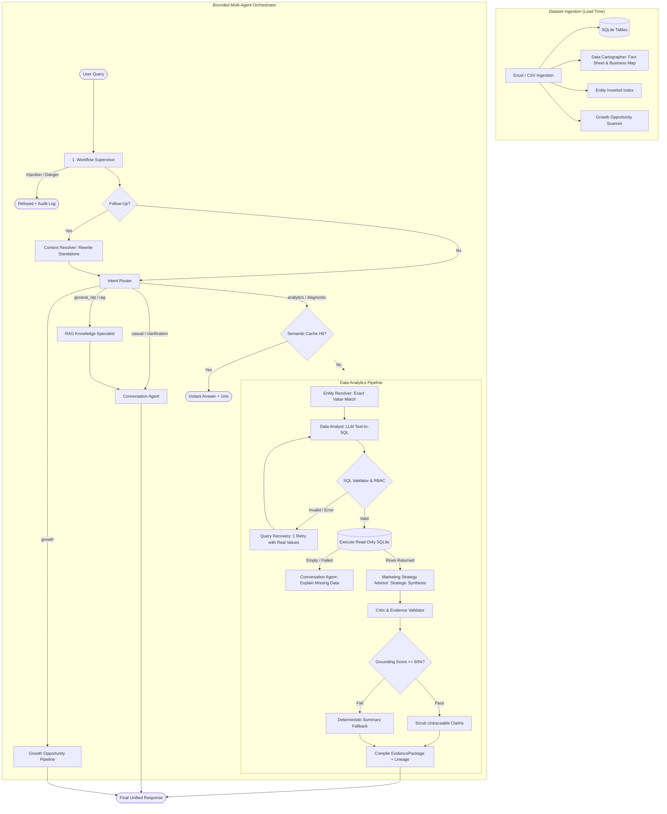
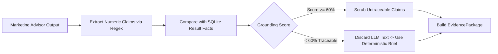

# Bounded Multi-Agent Workflow Architecture

The **Maruti Suzuki Marketing Intelligence AI** uses a bounded, deterministic multi-agent pipeline inspired by the LangGraph pattern. Instead of open-ended agentic loops that can run unbounded, wander, or exceed budgets, this architecture executes an orchestrated, intent-driven workflow in plain TypeScript ([bounded-orchestrator.ts](file:///Users/sjain24/coding/dentsu/maruti-bot/src/lib/multi-agent/bounded-orchestrator.ts)).

Every question is routed to a specialized path, bounded by strict latency and token budgets, checked by deterministic validators, and verified by a critic agent before delivery.

---

## Table of Contents

1. [Architectural Principles](#architectural-principles)
2. [End-to-End Workflow Diagram](#end-to-end-workflow-diagram)
3. [The Agent Team](#the-agent-team)
   - [1. Workflow Supervisor](#1-workflow-supervisor)
   - [2. Data Cartographer](#2-data-cartographer)
   - [3. Context & Follow-Up Resolver](#3-context--follow-up-resolver)
   - [4. RAG Knowledge Specialist](#4-rag-knowledge-specialist)
   - [5. Entity Resolver](#5-entity-resolver)
   - [6. Data Analyst & SQL Engine](#6-data-analyst--sql-engine)
   - [7. Query Recovery Agent](#7-query-recovery-agent)
   - [8. Marketing Strategy Advisor & Diagnostic Agent](#8-marketing-strategy-advisor--diagnostic-agent)
   - [9. Critic & Evidence Validator](#9-critic--evidence-validator)
   - [Branch Agent: Conversation Specialist](#branch-agent-conversation-specialist)
   - [Branch Agent: Growth Opportunity Analyst & Advisor](#branch-agent-growth-opportunity-analyst--advisor)
4. [Intent-Based Execution Paths](#intent-based-execution-paths)
5. [Resource & Latency Budgets](#resource--latency-budgets)
6. [Evidence Verification & Grounding](#evidence-verification--grounding)
7. [Security, RBAC, and Auditability](#security-rbac-and-auditability)
8. [Data Contracts & Schemas](#data-contracts--schemas)
9. [Debugging & Observability](#debugging--observability)

---

## Architectural Principles

| Principle | Implementation | Why It Matters |
|---|---|---|
| **Bounded Execution** | Strict state machine in TypeScript; no unbounded while-loops or free-form LLM planner decisions. | Eliminates infinite loops, token blowups, and unpredictable latency. |
| **Budgeted LLM Calls** | Maximum 2 LLM calls on the primary data path (Text-to-SQL + Strategic Synthesis). | Predictable costs and response times (< 2-4 seconds average). |
| **Deterministic Fallbacks** | Rule-based SQL compiler, precomputed fact sheets, and template summaries at every step. | 100% operational uptime even if the LLM provider fails, times out, or has no API key. |
| **Zero-Hallucination Critic** | Every single numeric claim in text is verified against SQLite rows; $\ge 60\%$ numeric grounding threshold. | Marketing executives can safely make capital allocation decisions based on numbers. |
| **Transparent Execution Plan** | Every agent logs an `AgentStep` (thought, action, summary, latency). | Full explainability in the UI: users see exactly how an answer was derived. |

---

## End-to-End Workflow Diagram



---

## The Agent Team

### 1. Workflow Supervisor
- **File:** [bounded-orchestrator.ts](file:///Users/sjain24/coding/dentsu/maruti-bot/src/lib/multi-agent/bounded-orchestrator.ts) (Step 1)
- **Uses LLM:** No
- **Latency:** ~1-5ms
- **Responsibilities:**
  - **Security Gatekeeper:** Validates user prompt via `validateUserInput(query)`. Blocks SQL injections, system prompt leak attempts, and jailbreaks. Records audit logs on rejection.
  - **Multilingual Normalization:** Detects English, Hindi, or Hinglish via `detectLanguageAndNormalize()`. Extracts inline entity mentions (dealerships, models, metrics).
  - **Intent Classification:** Classifies question intent into one of 7 categories:
    - `casual`: Greetings, thanks, capabilities.
    - `clarification`: Vague or incomplete requests.
    - `growth`: Strategic expansion, conversion improvement, targets.
    - `general_nlp`: Business concepts, metrics definitions.
    - `rag`: Questions about uploaded files and schema definitions.
    - `analytics`: Specific quantitative data queries.
    - `diagnostic`: "Why is X lagging?", root-cause, peer comparison.

### 2. Data Cartographer
- **File:** [data-understanding.ts](file:///Users/sjain24/coding/dentsu/maruti-bot/src/lib/data-understanding.ts)
- **Uses LLM:** Once at dataset load (cached in-memory for the dataset version)
- **Latency during query:** 0ms (In-memory retrieval)
- **Responsibilities:**
  - Ingests every row and table at load time.
  - Builds an exact fact sheet: row counts, column types, min/max periods, totals, and distributions.
  - Maps relationships across multiple sheets (e.g., joining booking funnels with lost leads).
  - Shares the consolidated business map (`semanticMap`) with all downstream agents.

### 3. Context & Follow-Up Resolver
- **File:** [conversation-agent.ts](file:///Users/sjain24/coding/dentsu/maruti-bot/src/lib/multi-agent/conversation-agent.ts) (`resolveFollowUp`)
- **Uses LLM:** Yes (fast call, timeout 4s, temperature 0), with rule-based fallback
- **Responsibilities:**
  - Evaluates pronoun-heavy or short queries (e.g., *"and for Pune?"*, *"what about its cancellations?"*).
  - Rewrites the message into a complete standalone analytical query that preserves filters, metrics, and grouping from prior conversation turns.

### 4. RAG Knowledge Specialist
- **File:** [rag-engine.ts](file:///Users/sjain24/coding/dentsu/maruti-bot/src/lib/rag-engine.ts)
- **Uses LLM:** No
- **Latency:** ~5-15ms
- **Responsibilities:**
  - Vector/BM25 keyword search across workbook documentation, data dictionaries, schema descriptions, and client notes.
  - Returns top relevant chunks (`RAGSourceChunk[]`) with source attribution.

### 5. Entity Resolver
- **File:** [entity-resolver.ts](file:///Users/sjain24/coding/dentsu/maruti-bot/src/lib/multi-agent/entity-resolver.ts)
- **Uses LLM:** No (Deterministic in-memory index)
- **Latency:** ~2-8ms
- **Responsibilities:**
  - Maps fuzzy colloquial names in the prompt to exact values in SQLite columns.
  - Example: User types `"kirti nagar"` $\rightarrow$ Entity Resolver identifies `showrooms.name = 'COMPETENT AUTOMOBILES - KIRTI NAGAR (ARENA)'`.
  - Employs longest-match substring matching, n-gram token overlap, and distinctness filtering (skipping UUIDs/dates).
  - Supplies `filterValueHints` to the query generator and recovery agent.

### 6. Data Analyst & SQL Engine
- **File:** [bounded-orchestrator.ts](file:///Users/sjain24/coding/dentsu/maruti-bot/src/lib/multi-agent/bounded-orchestrator.ts) (Step 3) & [gemini-service.ts](file:///Users/sjain24/coding/dentsu/maruti-bot/src/lib/gemini-service.ts)
- **Uses LLM:** Yes (Primary Text-to-SQL call)
- **Responsibilities:**
  - Generates SQLite-compliant `SELECT` statements using schema definitions and Cartographer business maps.
  - Handles multi-part questions by producing an array of planned queries (`PlannedQuery[]`).
  - **Diagnostic Specialist:** Generates automated peer-comparison queries (`segmentComparisonQuery`) when "why is X lagging?" is asked.
  - **Deterministic Fallback:** If the LLM is disabled or unavailable, invokes the keyword-based SQL compiler (`compileRAGSQL`).
  - Passes all generated SQL through `applyRBACScopeToSQL` and `validateAndSanitizeSQL` before execution.

### 7. Query Recovery Agent
- **File:** [bounded-orchestrator.ts](file:///Users/sjain24/coding/dentsu/maruti-bot/src/lib/multi-agent/bounded-orchestrator.ts) & [entity-resolver.ts](file:///Users/sjain24/coding/dentsu/maruti-bot/src/lib/multi-agent/entity-resolver.ts)
- **Uses LLM:** Yes (1 bounded retry round)
- **Responsibilities:**
  - Triggered when a generated query either throws a database error or returns 0 rows / all-NULL aggregates.
  - Gathers real column values from `filterValueHints` and provides them back to the LLM:
    ```
    Your previous query returned 0 rows: SELECT ... WHERE model = 'Brezza'
    Real values in column 'model': 'VITARA BREZZA', 'NEW BREZZA', ...
    ```
  - Allows the LLM one self-correction attempt to fix filters or table joins.

### 8. Marketing Strategy Advisor & Diagnostic Agent
- **File:** [bounded-orchestrator.ts](file:///Users/sjain24/coding/dentsu/maruti-bot/src/lib/multi-agent/bounded-orchestrator.ts) (Step 4) & [diagnostic-advisor.ts](file:///Users/sjain24/coding/dentsu/maruti-bot/src/lib/diagnostic-advisor.ts)
- **Uses LLM:** Yes (Strategic synthesis in `medium` and `large` output modes)
- **Responsibilities:**
  - Transforms raw database rows into an executive summary, strategic takeaways, and tactical marketing recommendations.
  - Injects relevant growth levers from the precomputed growth analysis.
  - Runs deep root-cause diagnostic comparisons (`generateEvidenceBasedDiagnostic`) when diagnosing underperformance.
  - Adapts length and depth according to the active `outputMode` (`small`, `medium`, `large`).

### 9. Critic & Evidence Validator
- **File:** [answer-facts.ts](file:///Users/sjain24/coding/dentsu/maruti-bot/src/lib/answer-facts.ts) & [evidence-package.ts](file:///Users/sjain24/coding/dentsu/maruti-bot/src/lib/evidence-package.ts)
- **Uses LLM:** No
- **Latency:** ~1-3ms
- **Responsibilities:**
  - Extracts all numeric claims from the synthesized marketing brief using regex.
  - Verifies each number against the executed SQLite results and computed reference facts.
  - **Grounding Enforcement:** Computes a grounding score (`matched / checked`).
    - If score $\ge 60\%$: Runs `scrubNarrative` to delete individual unverified sentences/bullets.
    - If score $< 60\%$: Rejects the LLM narrative entirely and replaces it with the deterministic rule-based brief.
  - Compiles the tamper-evident `EvidencePackage` (lineage, SQL queries, confidence score, row counts).

### Branch Agent: Conversation Specialist
- **File:** [conversation-agent.ts](file:///Users/sjain24/coding/dentsu/maruti-bot/src/lib/multi-agent/conversation-agent.ts)
- **Uses LLM:** Yes (temperature 0.3-0.7)
- **Situations:**
  - `chat`: Greets users and explains bot capabilities in context of the uploaded dataset.
  - `general`: Explains high-level marketing concepts (CAC, ROAS, LTV) or dataset structure.
  - `ambiguous`: Generates one concise clarifying question with 3-4 interactive options.
  - `unanswered`: Conducts a transparent gap analysis—explaining exactly what columns/sheets are missing to answer the query, what data *is* present, and suggesting the closest possible alternative questions.

### Branch Agent: Growth Opportunity Analyst & Advisor
- **File:** [growth-opportunities.ts](file:///Users/sjain24/coding/dentsu/maruti-bot/src/lib/growth-opportunities.ts) & [bounded-orchestrator.ts](file:///Users/sjain24/coding/dentsu/maruti-bot/src/lib/multi-agent/bounded-orchestrator.ts)
- **Uses LLM:** Optional (deterministic brief is always ready; LLM provides strategic polish)
- **Responsibilities:**
  - Scans entire dataset at load/query time across 5 opportunity types:
    1. **Conversion Gaps:** Segments with high enquiry volume but sub-par conversion.
    2. **Target Shortfalls:** Areas trailing their monthly sales quota.
    3. **Momentum Loss:** Models/dealers showing sharp month-on-month declines.
    4. **Decline Trends:** Multi-period negative slopes.
    5. **Loss Reasons:** Dominant lost-lead categorization (e.g., pricing, competitor choice).
  - Ranks opportunities by impact and provides actionable next steps.

---

## Intent-Based Execution Paths

```
User Query
    │
    ├── [casual] ──────────────────────────► Conversation Agent (chat)
    │
    ├── [clarification] ───────────────────► Conversation Agent (ambiguous options)
    │
    ├── [general_nlp / rag (no file)] ─────► RAG Specialist ──► Conversation Agent
    │
    ├── [growth] ──────────────────────────► Growth Analyst ──► Growth Advisor ──► Critic
    │
    └── [analytics / diagnostic] ──────────► Semantic Cache Hit?
                                                  │
                                          ┌───────┴───────┐
                                      (Yes)              (No)
                                        │                 │
                                    Return <1ms    Entity Resolver
                                                          │
                                                    Data Analyst (Text-to-SQL)
                                                          │
                                                    SQL Validation & RBAC
                                                          │
                                                    Execute on SQLite
                                                          │
                                               [0 rows] ──┴── [Has rows]
                                                  │                 │
                                          Query Recovery     Marketing Advisor
                                          (1 retry round)           │
                                                              Critic (Grounding >= 60%)
                                                                    │
                                                             Evidence Package
```

---

## Resource & Latency Budgets

To prevent runaway latencies and token spikes, the orchestrator enforces strict time and call budgets:

| Constant | Value | Purpose |
|---|---|---|
| `PIPELINE_LLM_BUDGET_MS` | 20,000 ms | Total time budget for LLM operations on standard datasets. |
| `PIPELINE_LLM_BUDGET_WITH_DICTIONARY_MS` | 28,000 ms | Extended budget when large data dictionaries are injected into prompts. |
| `MIN_SYNTHESIS_WINDOW_MS` | 2,000 ms | If less than 2s remains after SQL execution, LLM synthesis is skipped. |
| `SYNTHESIS_TIMEOUT_MS` | 8,000 ms | Standard marketing advisor timeout. |
| `SYNTHESIS_TIMEOUT_MULTI_PART_MS` | 18,000 ms | Extended synthesis timeout for multi-table / large output queries. |
| `MIN_NUMERIC_GROUNDING` | 0.60 (60%) | Minimum percentage of numbers that must directly match query results. |

### Output Mode Latency Profiles

- **`small` Mode:**
  - Instantly builds a deterministic brief from calculated facts.
  - Skips LLM synthesis entirely ($\text{latency} < 10\text{ms}$).
  - Ideal for mobile devices and high-frequency queries.
- **`medium` Mode:**
  - 1 SQL generation call + 1 concise strategic synthesis call.
  - Typical response time: 1.5s - 3.5s.
- **`large` Mode:**
  - Generates multi-part queries, deep peer diagnostics, and exhaustive action plans.
  - Typical response time: 3.5s - 6.5s.

---

## Evidence Verification & Grounding

The **Critic & Evidence Validator** prevents hallucinations through a multi-tiered verification pipeline:



1. **Extraction:** Identifies every number, currency value, percentage, and integer in the narrative.
2. **Matching:** Checks against:
   - Primary query result table
   - Supporting multi-part analysis tables
   - Calculated aggregates (sums, averages, min/max, percentages)
   - Profile benchmark rates
3. **Scrubbing:**
   - Sentences containing unverified figures are removed.
   - Entire takeaway or recommendation bullet points with ungrounded figures are filtered out.
4. **EvidencePackage Assembly:**
   - Emits a unique package ID (`pkg_<timestamp>_<hash>`).
   - Attaches data lineage (exact sheet names, source ranges, join keys).
   - Computes a final confidence score ($0.0 - 1.0$) based on numeric grounding, query validity, and dataset freshness.

---

## Security, RBAC, and Auditability

### 1. Guardrail Validation
Every prompt is evaluated by `validateUserInput()` prior to routing:
- Detection of SQL injection vectors (`DROP`, `DELETE`, `UPDATE`, `; --`).
- Detection of jailbreak delimiters and instruction-override tokens (`ignore previous instructions`, `<|im_start|>`).
- Violations trigger an immediate HTTP rejection and an audit record with `SECURITY_BLOCKED`.

### 2. Role-Based Access Control (RBAC)
User security contexts (`UserSecurityContext`) enforce row-level data scoping:
```typescript
applyRBACScopeToSQL(sql: string, securityContext?: UserSecurityContext): string
```
- A Regional Manager's query is automatically injected with:
  `WHERE region = 'North'`
- A Showroom Manager is scoped to their specific `dealer_id`.

### 3. Read-Only SQL Sandbox
- Database access is strictly read-only (`PRAGMA query_only = ON`).
- SQLite table names are checked against `getAllowedTableNames(metadata)`.
- Disallowed functions, subqueries into schema tables, or non-whitelisted tables are rejected by `validateAndSanitizeSQL`.

### 4. Audit & QA Logging
- **Audit Logger (`auditLogger.record`):** Records user identity, role, timestamp, query summary, latency breakdown, and security flags.
- **QA Logger (`logQATransaction`):** Logs transaction details (tables used, rows returned, model utilized, grounding score) for continuous evaluation.

---

## Data Contracts & Schemas

### Agent Step Record
```typescript
export interface AgentStep {
  agentId: 'supervisor' | 'cartographer' | 'entity_resolver' | 'recovery' | 
           'conversation' | 'rag_knowledge' | 'data_analyst' | 'marketing_advisor' | 'critic';
  agentName: string;
  role: string;
  status: 'completed' | 'skipped' | 'executing';
  thoughtProcess: string;
  actionTaken: string;
  outputSummary: string;
  latencyMs: number;
}
```

### Execution Plan
```typescript
export interface MultiAgentExecutionPlan {
  userQuery: string;
  resolvedQuery: string;
  intent: IntentType;
  extractedEntities: {
    dealerships?: string[];
    models?: string[];
    fuelTypes?: string[];
    regions?: string[];
    channels?: string[];
    metrics?: string[];
  };
  steps: AgentStep[];
  totalLatencyMs: number;
}
```

### Unified Assistant Response
The response returned to the frontend UI includes:
- `answer` / `summary`: Verified executive briefing.
- `insights`: Bulleted strategic takeaways.
- `recommendations`: Tactical marketing action items.
- `data`: Raw tabular rows for data grid export.
- `visualization`: Recommended chart config (bar, line, pie).
- `sql`: The validated SQL query and execution duration.
- `evidencePackage`: Grounding statistics, lineage, and confidence score.
- `agentExecutionPlan`: The complete timeline of agent thoughts and actions.

---

## Debugging & Observability

### Trace Logs in Development
When running queries locally or inspecting logs (`./start.sh --logs`):
```text
[INFO] Input in english. Resolved to canonical query: "Show top 5 showrooms by sales in Gujarat".
[INFO] Classified intent as analytics (confidence: 0.95)
[INFO] Entity Resolver: 1 value(s) resolved ("gujarat" -> showrooms.state = 'Gujarat')
[INFO] Data Analyst: Executing SQL in 1.8ms (5 rows returned)
[INFO] Critic: 5/5 figures verified (100% grounding). Compiled EvidencePackage pkg_1710001
[INFO] Answer sources: showrooms (Sheet: Showroom_Master, Range: A1:G50)
```

### Testing the Pipeline
To run the automated multi-agent evaluation suite:
```bash
npm run test:eval
# or execute directly:
npx tsx tests/eval-suite.ts
```
The evaluation suite tests:
1. Intent classification accuracy across all 7 intent types.
2. Injection block rates and security perimeter integrity.
3. Follow-up resolution consistency.
4. Grounding verification on complex synthetic datasets.
5. Zero-LLM deterministic fallback reliability.
